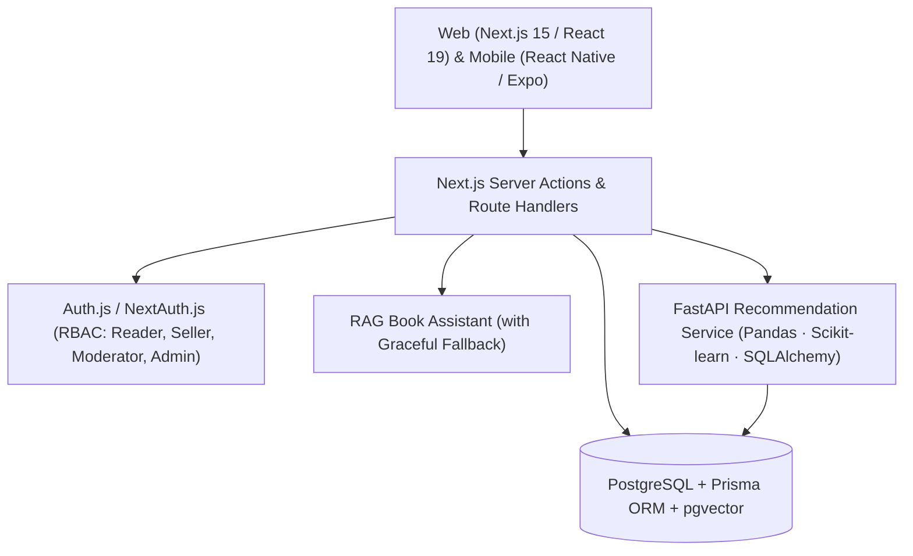

# BookVerse AI — Smart Online Bookstore, E-Book Reader &amp; RAG Platform


**BookVerse AI** là nền tảng nhà sách trực tuyến thông minh tích hợp khám phá sách, đọc E-Book trực tuyến, gói hội viên, chợ sách (Marketplace) và hệ thống gợi ý kết hợp **RAG Assistant**. Dự án kết hợp ứng dụng web **Next.js 15 + React 19** với dịch vụ recommendation **FastAPI**, sử dụng **PostgreSQL + Prisma + pgvector** làm tầng dữ liệu chính.

---

## Kiến Trúc Hệ Thống (System Architecture)



---

## Tính Năng Nổi Bật (Core Features)

- **Xác thực &amp; Phân quyền đa vai trò:** Đăng ký, đăng nhập, quên mật khẩu và phân quyền rõ ràng cho **Độc giả (Reader)**, **Người bán (Seller)**, **Kiểm duyệt viên (Moderator)** và **Quản trị viên (Admin)**.
- **Trợ lý AI & Gợi ý thông minh:**
  - Gợi ý sách kết hợp **Popularity + Content + Behavior** từ dữ liệu tương tác người dùng.
  - Trợ lý AI **RAG** hỗ trợ hỏi đáp và tìm kiếm sách theo ngữ nghĩa với **pgvector**, có cơ chế fallback khi dịch vụ ngoài không khả dụng.
- **Trình đọc E-Book trực tuyến:** Hỗ trợ đọc thử, đọc toàn văn bản minh họa, lưu tiến độ đọc, **bookmark** và **highlight**.
- **Gói hội viên & Chợ sách (Marketplace):**
  - Mở khóa kho đọc theo thời hạn hội viên.
  - **Seller Dashboard** hỗ trợ đăng bán, quản lý listing, đơn hàng và doanh thu; giỏ hàng và thanh toán Sandbox/Demo.
- **Admin Center:** Quản lý người dùng, đầu sách, listing, đơn hàng, hội viên, nội dung và audit log hệ thống.

---

## Công Nghệ Sử Dụng (Tech Stack)

| Layer | Technologies |
|---|---|
| **Web Frontend** | Next.js 15, React 19, TypeScript, Tailwind CSS |
| **Mobile App** | React Native, Expo |
| **Backend &amp; Auth** | Next.js Server Actions &amp; Route Handlers, Auth.js / NextAuth.js |
| **AI &amp; Recommendation** | FastAPI, Pandas, Scikit-learn, SQLAlchemy, RAG |
| **Database &amp; Vector** | PostgreSQL, Prisma ORM, `pgvector` |
| **Container &amp; Demo** | Docker Compose |

---

## Cài Đặt & Chạy Nhanh (Quick Start)

**Yêu cầu môi trường:** Node.js 20+, PowerShell 7 (trên Windows), Docker Desktop.

```bash
git clone https://github.com/quoctuan364/bookverse-ai.git
cd bookverse-ai
npm run demo:bootstrap
npm run demo:start
```

Sau khi khởi chạy, truy cập ứng dụng tại: `http://127.0.0.1:3000`

---

## Tài Khoản Demo

| Vai trò | Email | Mật khẩu |
|---|---|---|
| **Độc giả (Reader)** | `reader.bookverse.demo@gmail.com` | `123456` |
| **Người bán (Seller)** | `seller.bookverse.demo@gmail.com` | `123456` |
| **Kiểm duyệt viên (Moderator)** | `moderator.bookverse.demo@gmail.com` | `123456` |
| **Quản trị viên (Admin)** | `admin.bookverse.demo@gmail.com` | `123456` |

> **Lưu ý:** Toàn bộ thanh toán trong hệ thống sử dụng môi trường **Sandbox / Demo** (không phát sinh giao dịch tiền thật). Một phần dữ liệu catalog, giá và tương tác sử dụng synthetic/demo data; các giới hạn và trạng thái kiểm chứng hiện hành được tài liệu hóa trong `docs/CURRENT_STATUS.md`.
